# CetiRun 使用指南

门户地址：<https://cetirun-qiah.eastus2.cloudapp.azure.com/>。用 Entra 账号登录，账号必须在 `cetirun-poc-users` 组里。

CetiRun 是**常驻型** runtime：每人一个长期运行的 agent 实例，跑在 Kata 沙箱里，状态都在它自己的 HOME 盘上，不做快照，也不按会话回收。和会话型 runtime 的取舍见 [系列 12：常驻实例与会话调度](https://github.com/huqianghui/mindforge/blob/main/Azure/Azure-Kubernetes-Service/AKS-Agent-Runtime%E7%B3%BB%E5%88%9712%EF%BC%9A%E5%B8%B8%E9%A9%BB%E5%AE%9E%E4%BE%8B%E4%B8%8E%E4%BC%9A%E8%AF%9D%E8%B0%83%E5%BA%A6.md)，门户和 LiteLLM 的分工见 [系列 13：Runtime 管控台与 LiteLLM 的分工](https://github.com/huqianghui/mindforge/blob/main/Azure/Azure-Kubernetes-Service/AKS-Agent-Runtime%E7%B3%BB%E5%88%9713%EF%BC%9ARuntime%E7%AE%A1%E6%8E%A7%E5%8F%B0%E4%B8%8ELiteLLM%E7%9A%84%E5%88%86%E5%B7%A5.md)。

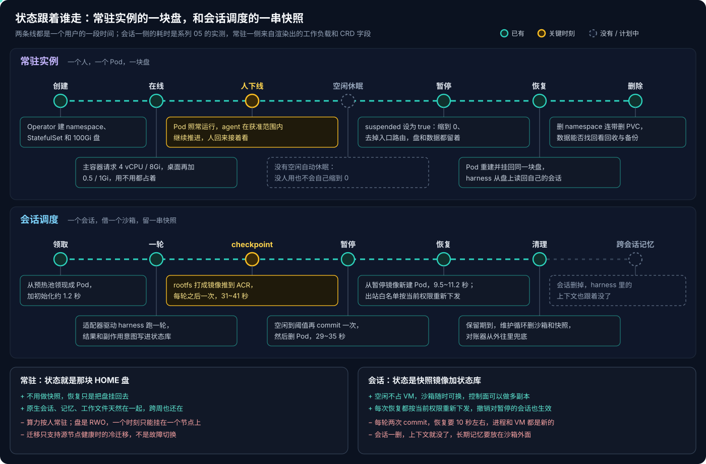

本文按实际操作顺序走一遍：管理员先准备 Sandbox、Policy、Team，用户再建自己的 agent、用三个入口干活，最后看门户上的配置怎么级联到 AI 网关（LiteLLM）。截图都来自当前在线环境，演示用的 Team 是 `demo-team`，agent 是 `demo-agent`。

## 一、四个对象

门户上的所有操作，最后都是对四个 Kubernetes CRD 的增删改。门户本身不存配置，operator 读这些 CRD，一边在 AKS 上起 Pod、HOME 盘和网络策略，一边把模型相关的规则单向写进 LiteLLM。

| 对象 | 谁来建 | 定义什么 |
|---|---|---|
| **Sandbox** | 管理员 | 资源规格：运行时（Kata / gVisor / runc）、CPU 内存上限、HOME 盘大小和 StorageClass、临时盘上限 |
| **Agent Policy** | 管理员 | 规则：允许哪些 harness 和 skill、哪些共享模型、能否用 GitHub Copilot、月度预算和限流、身份、网络、只读根文件系统 |
| **Team** | 管理员 | 把一个 Policy 和若干个 Sandbox 绑给一组人，加上团队角色、skill 和智能路由 |
| **Agent** | 用户 | 一个常驻实例：单副本 StatefulSet、一块 HOME 盘、一组网络策略、一把 LiteLLM key |

**真正可复用的是 Policy 和 Sandbox，Team 只做绑定。** 每个团队建一个自己的 Team，规则一样也分开建、引用同一个 Policy 和 Sandbox。原因在第四节：每个 Team 在 LiteLLM 里对应一个 team，用量和预算按它分开统计。

门户分两部分：

- **用户侧**（`/`）：My Agents、工作区、Connections；
- **管理员后台**（`/admin`）：Teams、Agent policies、Sandboxes、Agents、AI Gateway，只有门户管理员能看到：部署人 `OWNER_ALIAS`，加上 `config.env` 里 `PORTAL_ADMIN_ALIASES` 列出的人。不在名单里的人打开 `/admin` 会看到 403 Admin access required，这不是登录失败。怎么给别人开权限见 [README](../README.md#给其他人开权限)。

## 二、管理员：第一次准备

普通用户要能建 agent，至少要有一个可选的 Team。顺序是 Sandbox → Policy → Team。

### 1. Sandboxes：资源规格

**Admin → Sandboxes**。当前环境有一个 `sandbox-demo01`，运行时 Kata，HOME 盘 10 GiB。

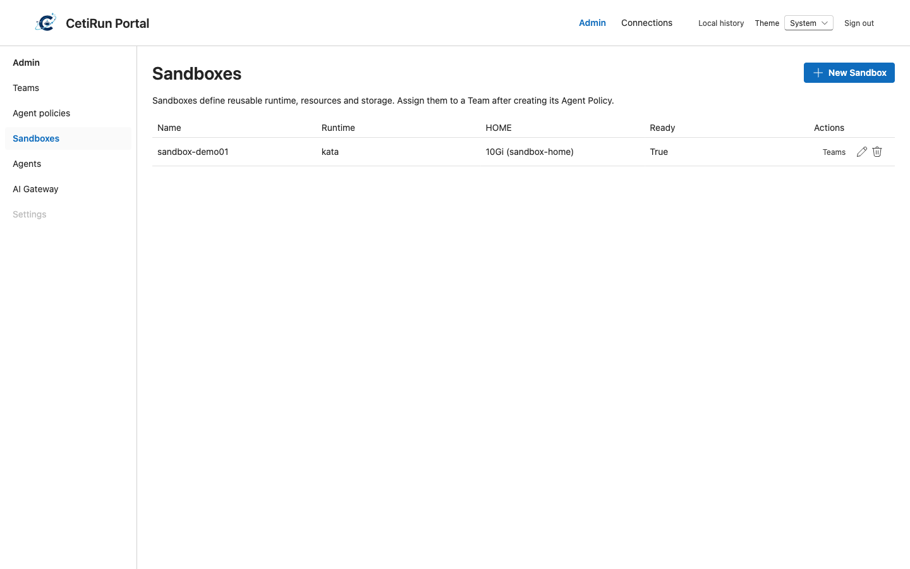

新建或编辑时：

- **Runtime**：`Kata`（每个 agent 一台轻量虚拟机，独立内核，推荐）、`gVisor`、`Container (runc, shared node kernel)`。后两种隔离弱，只用于测试；
- **Agent HOME**：HOME 盘的大小、StorageClass（只能选管理员批准过的）、访问模式。HOME 盘就是这个 agent 的全部长期状态；
- **Scratch size limit**：临时目录上限，实例重启后清空。

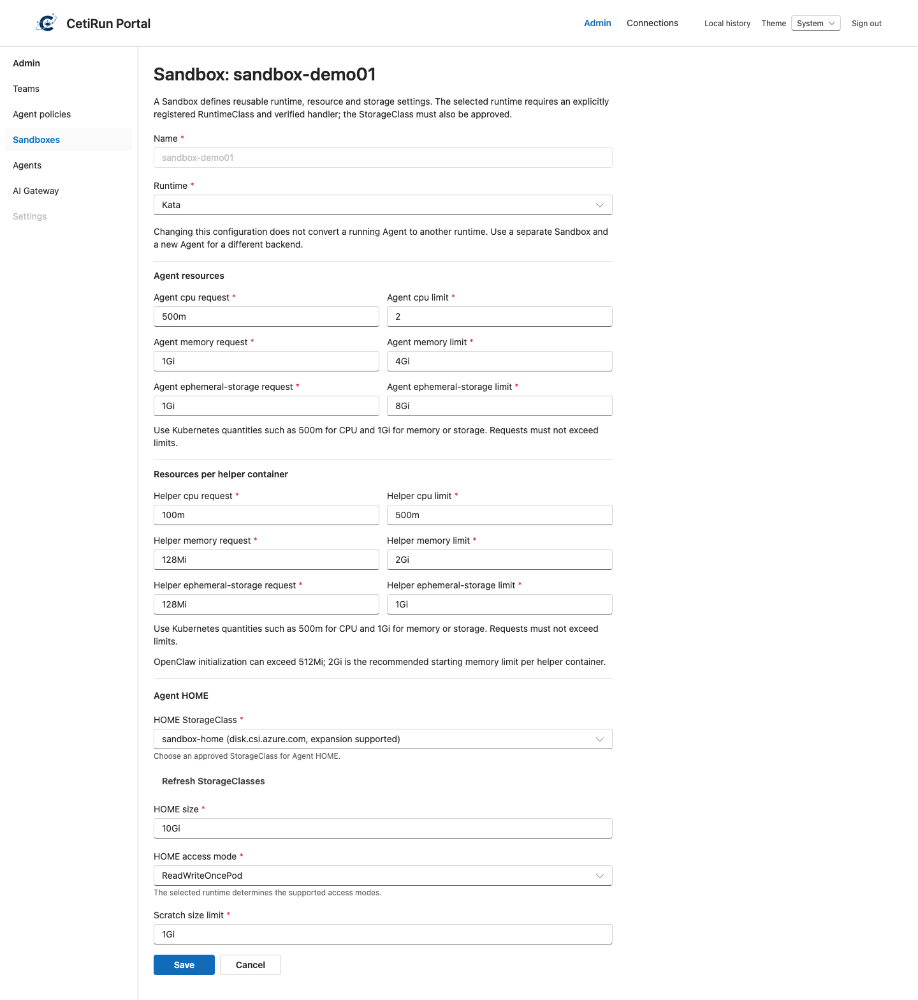

Sandbox 被 Team 引用时删不掉，要先让 Team 不再引用它。

### 2. Agent policies：规则

**Admin → Agent policies**，`agent-policy-demo01` 的 Accepted 为 `True`，表示 operator 校验通过、已经生效。

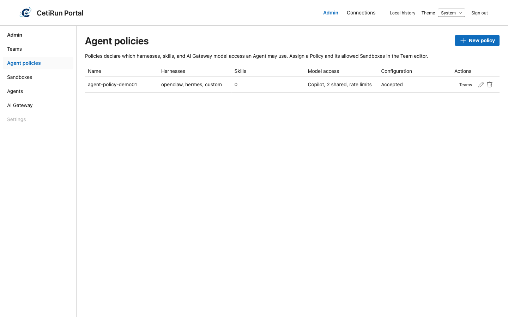

编辑页从上到下分几段。上半部分管"能装什么、能用哪些模型、能花多少"：

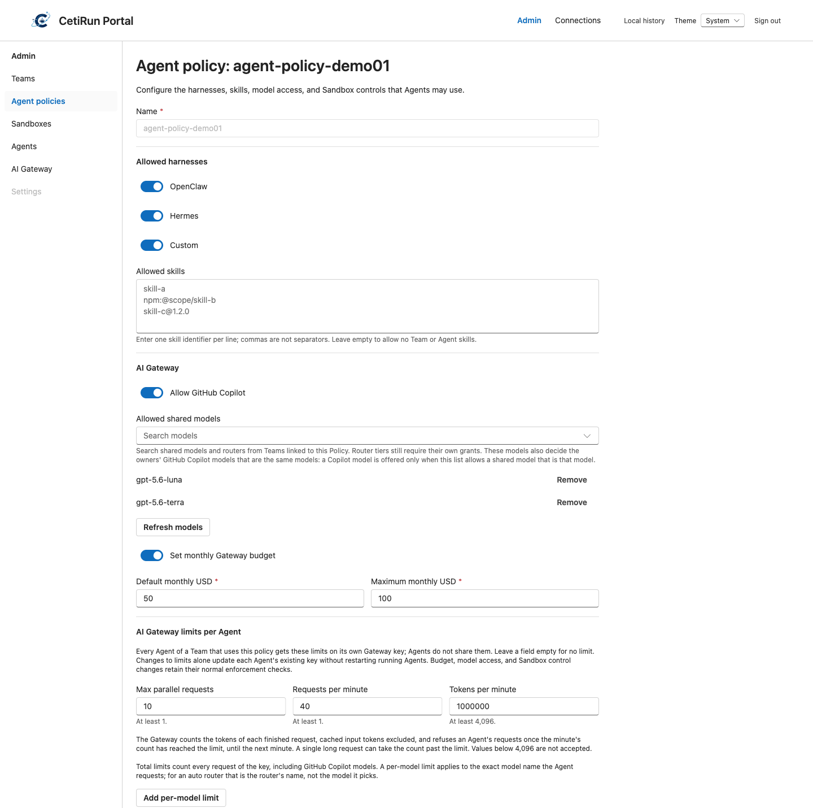

- **Allowed harnesses**：允许建哪几种 agent（OpenClaw、Hermes、Custom）；
- **Allowed skills**：skill 白名单，每行一个，留空表示不允许任何 skill；
- **AI Gateway**：是否允许接用户自己的 GitHub Copilot、可用的共享模型（这里是 `gpt-5.6-luna`、`gpt-5.6-terra`）、月度预算（默认 50 美元、上限 100 美元）；
- **AI Gateway limits per Agent**：每个 agent 自己那把 key 上的并发、RPM、TPM，这里是 10 / 40 / 1,000,000。**每个 agent 一把 key，不共用额度**；改了限额，已有 agent 的 key 也会更新，不用重启。还可以给单个模型单独限流（**Add per-model limit**）。

下半部分管身份、沙箱和网络：

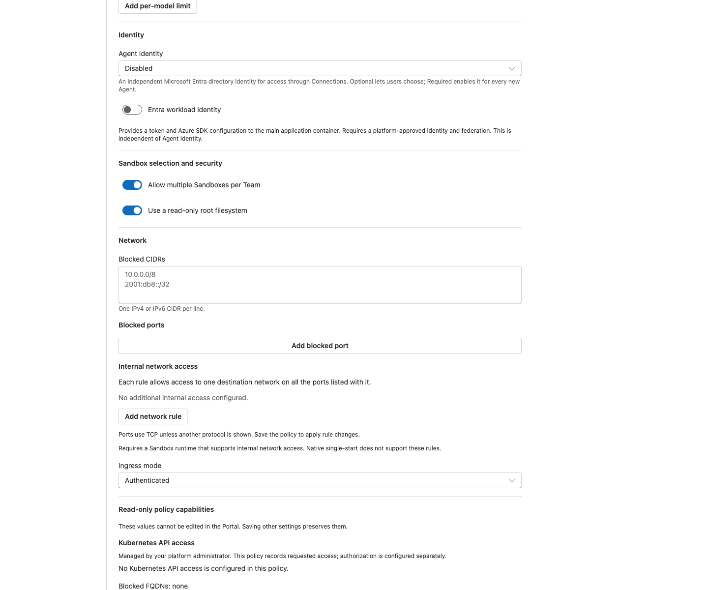

- **Identity**：Agent Identity 设为 Disabled（见"已知限制"）；Entra workload identity 用于让主容器拿到 Azure SDK 的令牌；
- **Sandbox selection and security**：一个 Team 能否允许多个 Sandbox、是否只读根文件系统；
- **Network**：公网出站默认放行，可以按 CIDR、端口封禁；内网默认不通，要访问内部服务就在 **Internal network access** 里按"目标网段 + 端口"一条条加；**Ingress mode** 是入口认证方式；
- **Read-only policy capabilities**：Kubernetes API 权限这类只能由平台管理员声明的能力，门户里只读。

保存后 operator 会重新校验。Policy 无效或读不到时，引用它的 agent 会被挂起，LiteLLM 里对应的 key 会被吊销，规则执行不了就不放行。这几类规则覆盖了 [系列 11](https://github.com/huqianghui/mindforge/blob/main/Azure/Azure-Kubernetes-Service/AKS-Agent-Runtime%E7%B3%BB%E5%88%9711%EF%BC%9AKubernetes%E5%8E%9F%E7%94%9F%E6%9C%BA%E5%88%B6%E7%AE%A1%E4%B8%8D%E5%88%B0%E4%BB%80%E4%B9%88.md) 清单里"能装什么、能花多少"那一半，出站逐请求授权、高风险动作审批这一半没有（见第七节）。

### 3. Teams：绑定给一组人

**Admin → Teams → New Team**：

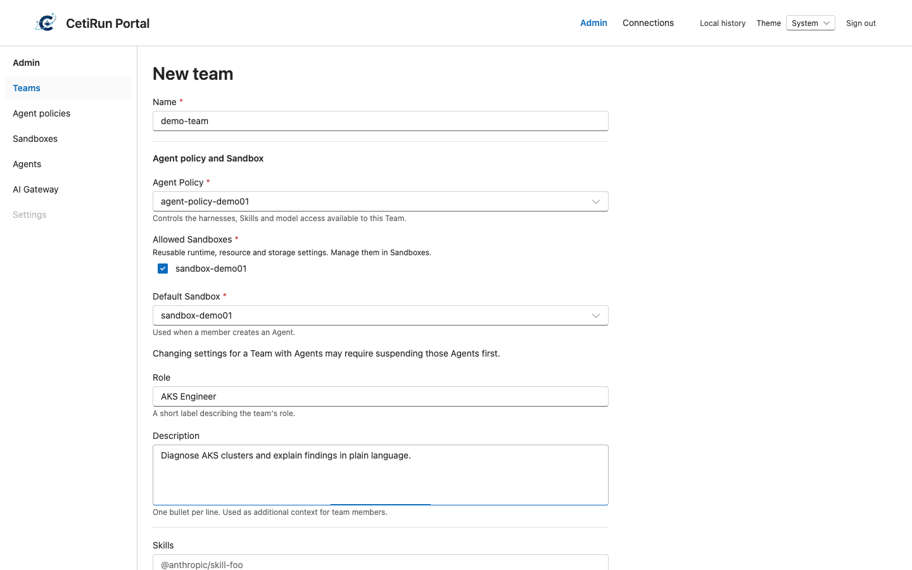

- **Agent Policy**：选上一步的 Policy；
- **Allowed Sandboxes / Default Sandbox**：这个团队能用哪几种规格，默认用哪个；
- **Role / Description**：团队角色说明，会作为上下文写进 agent。它只是给 agent 的提示，不授予任何权限；
- **Skills**：从 Skill Marketplace 选，或写 npm skill 包（每行一个，如 `npm:@scope/skill-a`）；
- **Smart routing**：可选，定义一个路由名，背后是几档模型加一个分类器，agent 用路由名调用，网关按问题难度转发；
- **Enable shared skill storage**：可选，挂一个团队共享的 skill 存储，团队里所有 agent 都能读到。

创建后列表里 **Compatibility** 变成 `Compatible`，表示 Policy 和 Sandbox 的绑定有效。列表上方的说明也写明了：Team 不维护成员名单，agent 的 owner 自己选 Team；在 LiteLLM 里，这个 Team 的用量和预算出现在 `cetirun-team-<名字>` 下面。

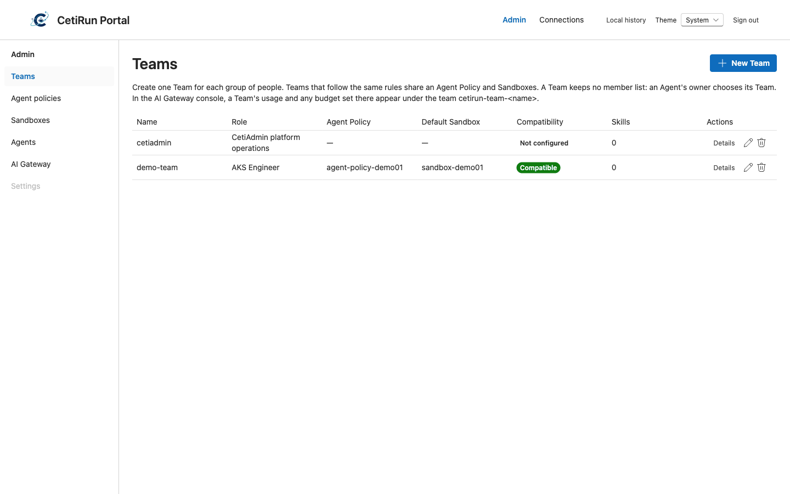

`cetiadmin` 是内置管理员 agent 所在的团队，Compatibility 显示 Not configured 是正常的，普通用户不要选它。

## 三、用户：创建和使用自己的 agent

### 1. 创建

**My Agents → New Agent**：

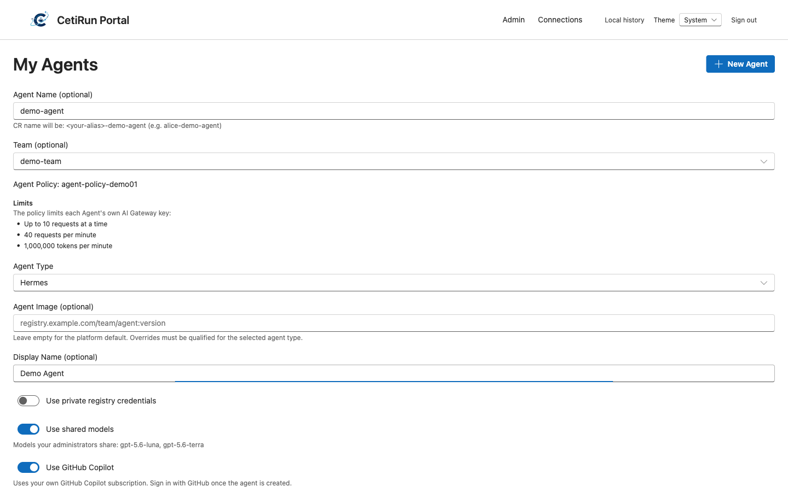

- **Team**：选自己的团队；
- **Agent Type**：`Hermes`（默认）、`OpenClaw`、`Custom`。Custom 要填自己的镜像，私有仓库可以填拉取凭据；
- **Agent Name / Display Name**：可以留空自动生成。实例的实际名字是 `<owner>-<agent name>`，这里是 `qiah-demo-agent`；
- **Use shared models / Default model**：用 Policy 允许的共享模型，可以指定默认模型；
- **Use GitHub Copilot**：Policy 允许时可以接自己的 Copilot 账号；
- **Enable Microsoft Entra Agent Identity**：Policy 里 Agent Identity 是 Disabled，所以这个开关不会出现。

提交后实例进入 Provisioning，这次约 4 分钟变成 Ready。

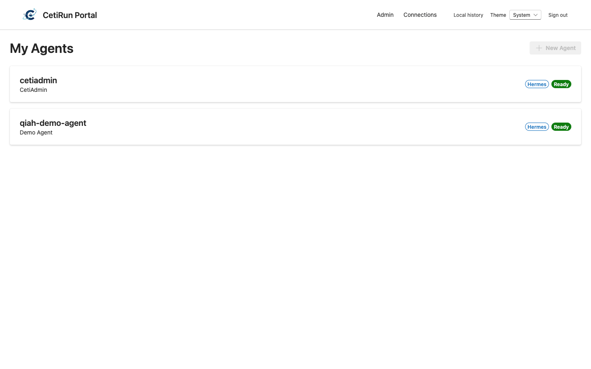

> [!NOTE]
> 每人可建的 agent 数由 `config.env` 的 `MAX_AGENTS_PER_USER` 决定（写进门户 chart 的 `features.maxInstancesPerUser`），默认 1，对应"每人一个常驻实例"的设计。当前环境为了演示设成了 2。名额满了 New Agent 按钮会变灰，提示 Limit reached。

### 2. 工作区

点开实例进入工作区。**Overview** 显示类型、镜像、用户名、端口、Agent UI 的登录凭据（**Hermes API / Webapp Key**，点眼睛显示、点复制按钮复制），以及这个 agent 能用的模型。

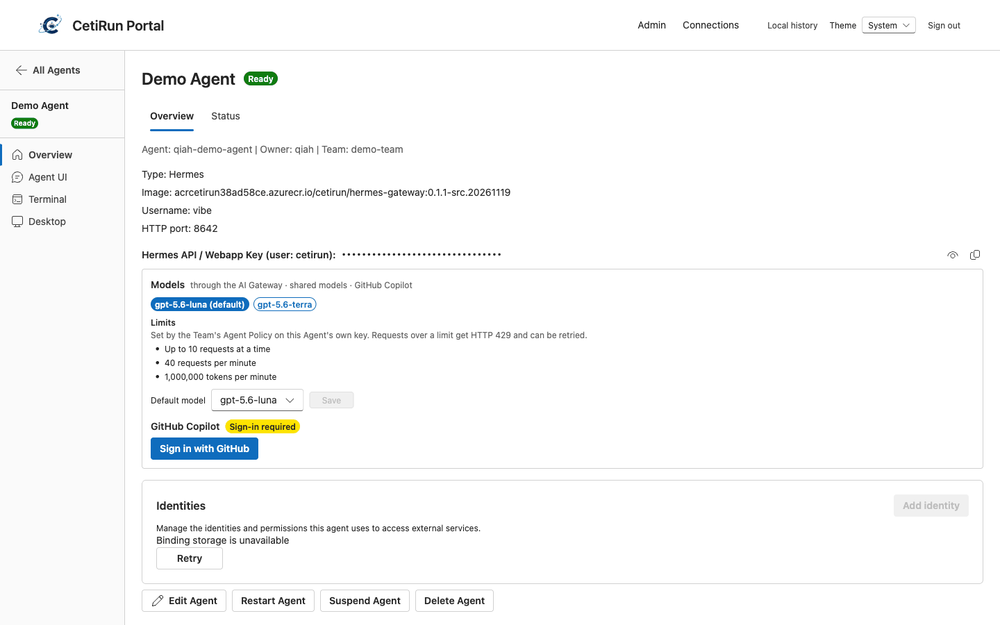

**Edit Agent** 可以改显示名、默认模型、是否提供 Web 界面；类型、owner、Team、Sandbox 建好后不能改。**Delete Agent 会连 HOME 盘一起删掉**（默认 StorageClass 的回收策略是 Delete）。

左侧是三个入口。它们进的是同一个 Pod 里的不同容器，都先过 Entra 登录，再过入口上的 owner 检查：**只有实例的 owner 能进**，管理员也进不了别人的工作区。

| 入口 | 地址 | 连到哪里 | 用来做什么 |
|---|---|---|---|
| **Agent UI** | `/ui/<实例名>/` | 主容器里 harness 自带的 Web 界面 | 日常主入口：交代任务，看回复和工具调用 |
| **Terminal** | `/<实例名>/term` | 主容器里的网页 shell（ttyd） | 绕过 agent 直接操作它的环境 |
| **Desktop** | `/<实例名>/desktop` | 桌面边车里的 noVNC 和 Chrome | 看 agent 用的浏览器，必要时接手 |

### 3. Agent UI：让它做

Agent UI 有自己的一层登录，和门户的 Entra 登录是两回事。用户名是 `cetirun`，密码是 Overview 里的 Webapp Key。

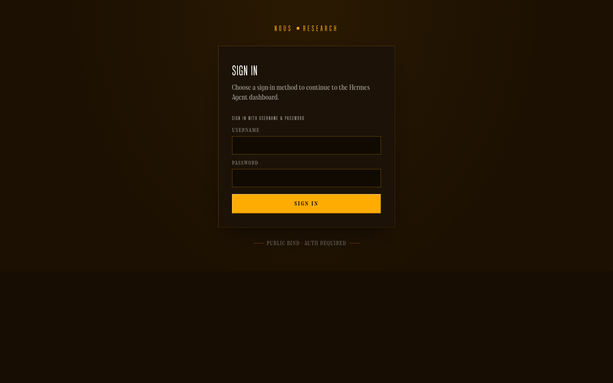

登录后就是 Hermes 的界面：左边是会话列表，下面输入任务，右下角能看到当前用的模型（这里是 `GPT-5.6-luna`）。agent 运行命令时，回复里会折叠显示 "Ran uname -r + 1 command"，点开能看到命令和输出。

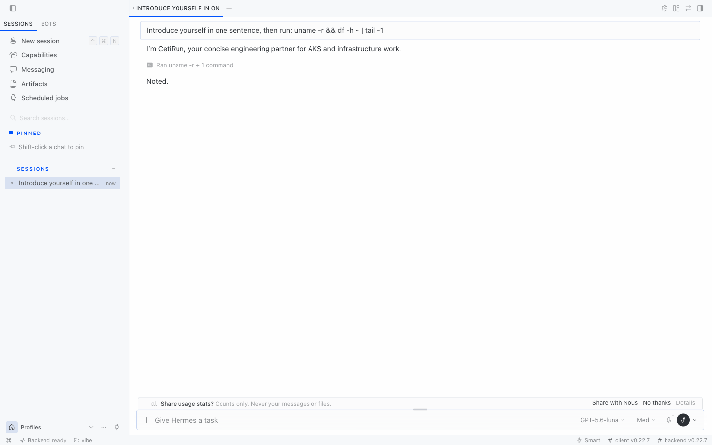

### 4. Terminal：我自己来

Terminal 是这台机器唯一正式的 shell 入口。集群上的准入策略拒绝对 agent Pod 做 `kubectl exec`，`kubectl port-forward` 也连不到 Kata 虚拟机里的端口，所以管理员也没有别的路进去。


截图里能看到几件事：用户是 `vibe`（和 agent 同一个用户），内核是 `6.18.52.mshv1`（Kata 虚拟机自己的内核，不是节点内核），HOME 盘 9.8G，`~/.hermes`、`~/.agents`、`~/.aks-skills` 这些 agent 的状态和 skill 都在盘上。实例重启后这些都还在，这就是常驻形态。

### 5. Desktop：看着它，或者替它过一关

Desktop 用来处理 agent 自己过不了的关，比如需要验证码或 MFA 的登录：人在桌面里登录一次，cookie 留在这个 Chrome 里，agent 之后接着用。agent 通过本机 CDP 端口操作这个浏览器，人能实时看到。

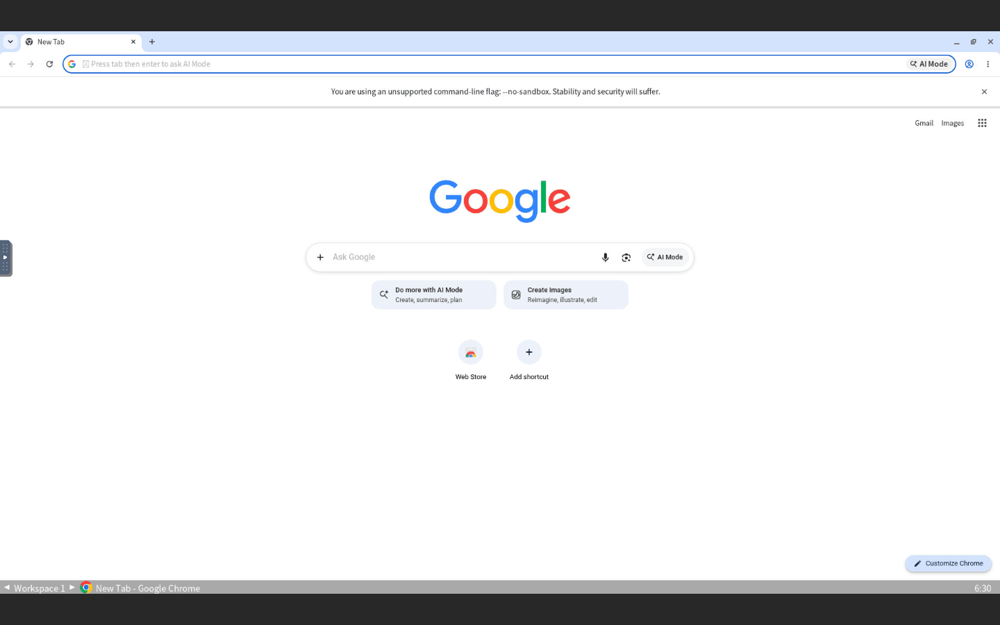

打开后是 noVNC 远程桌面，里面就是 agent 用的 Chrome。顶部的 `--no-sandbox` 提示是正常的：Chrome 自身不开沙箱，隔离靠 Kata 虚拟机和入口的 owner 检查，把 agent 开给别人用之前要清楚这一点。

> [!NOTE]
> Desktop 能不能连上，取决于平台登记（`cetirun-system/sandbox-platform`）里入口网关可访问的端口有没有 noVNC 的 `6080`。这份登记由 `deploy/55-sandbox-platform.sh` 生成，端口列表在 `config.env` 的 `SANDBOX_INGRESS_PORTS`。少了 6080，页面会报 `upstream connect error ... connection timeout`。

### 6. Connections：让 agent 代表你访问 Microsoft 服务

**Connections** 页管理委托连接，授权 agent 以你的身份访问 Microsoft Graph 或 Azure ARM。连接从 agent 侧发起：在工作区 Overview 的 **Identities → Add identity** 里完成授权后，会出现在这里，并显示被哪些 agent 用着。这个功能需要租户管理员同意后才能用。

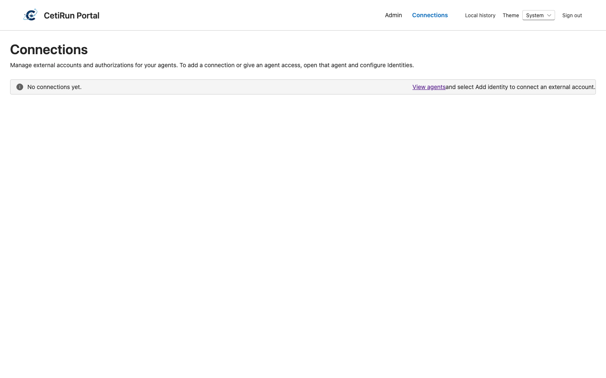

## 四、门户配置怎么级联到 LiteLLM


模型调用都走 AI 网关（LiteLLM）。agent 只拿着自己的 key 调网关的 OpenAI 兼容接口，模型凭据留在网关里，沙箱里没有。operator 把门户上的配置单向写进 LiteLLM，LiteLLM 里的改动不会回流。

### 1. 打开 LiteLLM 控制台

**Admin → AI Gateway** 里嵌着 LiteLLM 控制台，也可以直接打开 `/ai-gateway/ui/`。要登录两次：先过 Entra（嵌在门户里时无感），再用 LiteLLM 的 admin 账号。

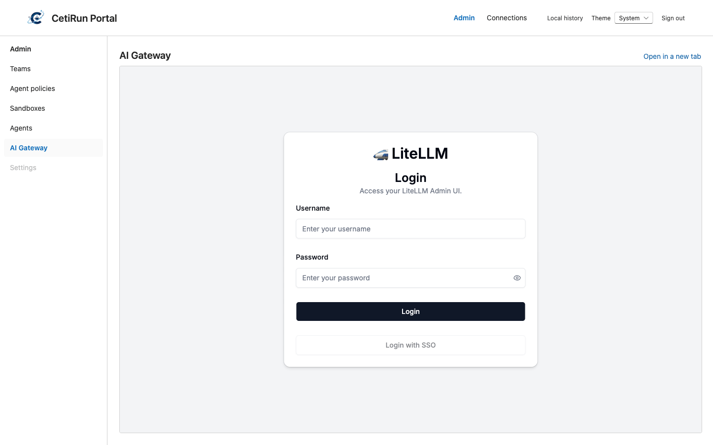

用户名 `admin`，密码这样取（不要写进文档或聊天记录，控制台登录就等于拿到了管理 API）：

```bash
kubectl get secret -n cetirun-system cetirun-ai-gateway-auth -o jsonpath='{.data.ui-password}' | base64 -d
```

### 2. 建一个 Team、一个 agent，LiteLLM 里多了什么

建完 `demo-team` 和 `demo-agent` 之后，不用在 LiteLLM 里做任何操作，下面这些就都出现了。

**Virtual Keys**：多了一把 `cetirun-qiah-demo-agent-<UID>`，Team 是 `demo-team`，User 是 `qiah`，预算 $50。另一把是内置管理员 agent 的。

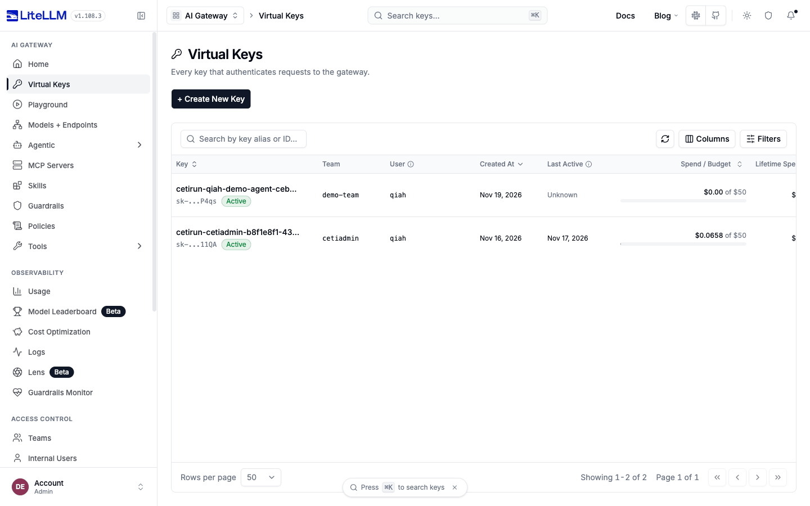

**Teams**：多了一个 `demo-team`，ID 是 `cetirun-team-demo-team`。

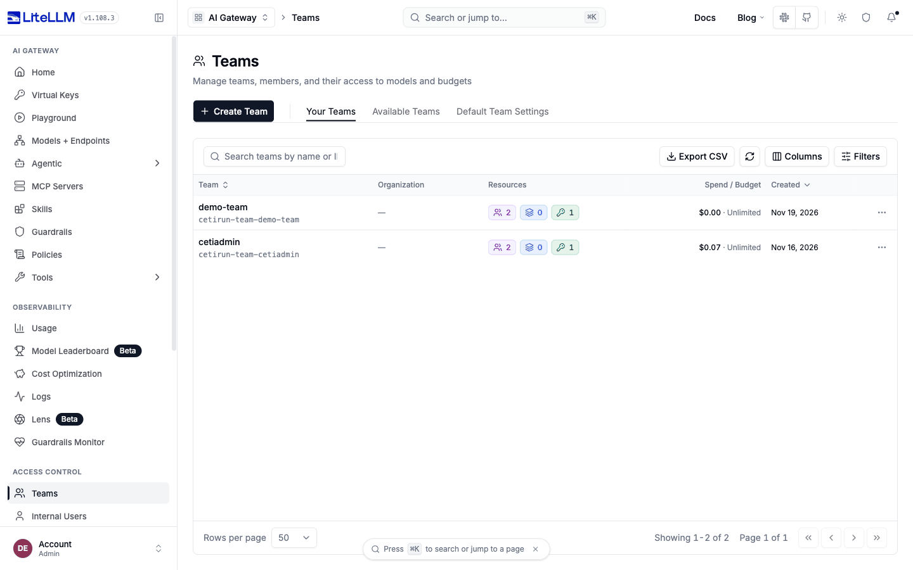

**Internal Users**：owner `qiah` 是一个 LiteLLM 用户，名下有 key，用量按人汇总在这里。`default_user_id` 是控制台的 admin 账号。

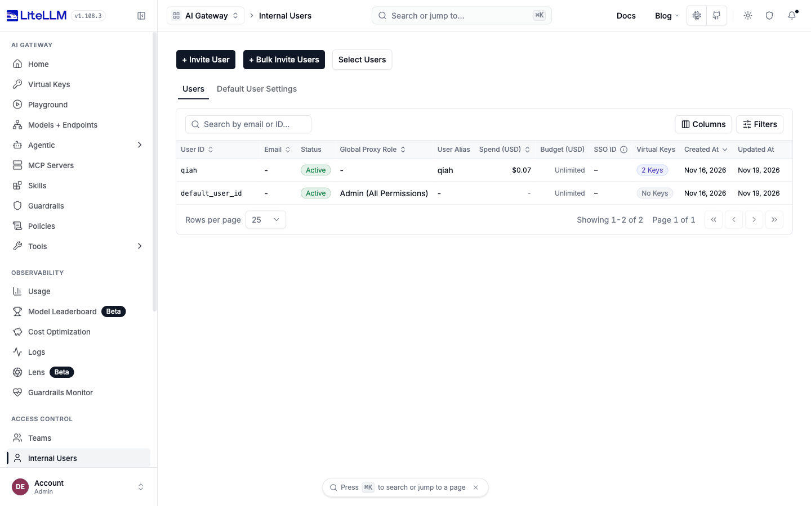

**Models + Endpoints**：两个共享模型，来源是 AI 网关的 Helm 配置（Defined in config），价格也在那里配。

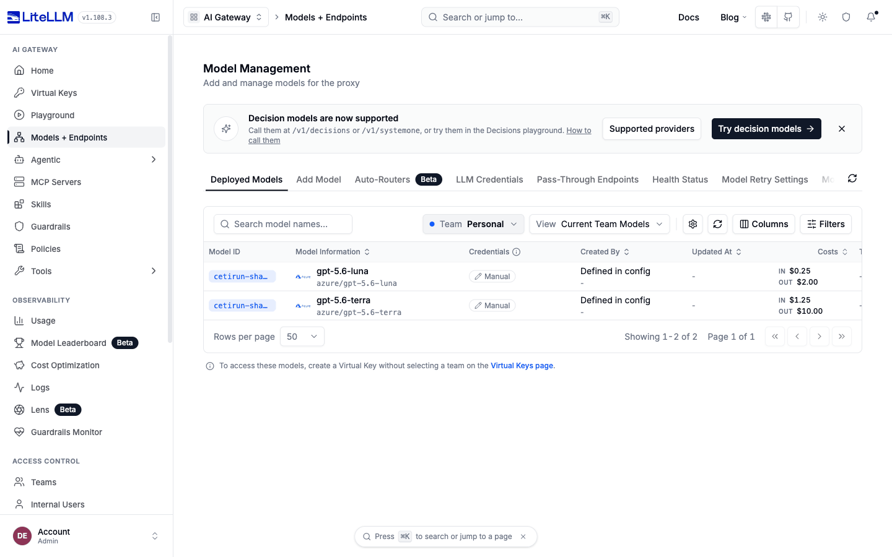

### 3. 逐项对照

打开这把 key 的详情，能看到它挂在 `cetirun-team-demo-team` 下面、owner 是 `qiah`：

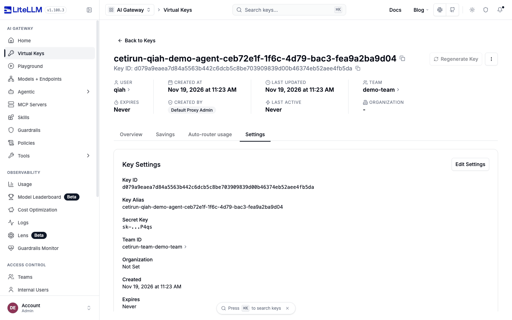

key 上的限额和 Policy 逐项一致（用 LiteLLM 管理 API `/key/info` 读出来的实际值）：

| 门户上的配置 | LiteLLM key 上的值 |
|---|---|
| Policy 默认月度预算 50 美元 | `max_budget = 50`，`budget_duration = 1mo` |
| Policy RPM 40 | `rpm_limit = 40` |
| Policy TPM 1,000,000 | `tpm_limit = 1000000` |
| Policy 并发 10 | `max_parallel_requests = 10` |
| Policy 共享模型 luna、terra，允许 Copilot | `models` = 两个共享模型的内部名，加上这个 agent 专属的 Copilot 路由 |
| agent 的 Team `demo-team` | `team_id = cetirun-team-demo-team` |
| agent 的 owner `qiah` | `user_id = qiah` |

Team 详情页的 Rate Limits、Budget 都是 Unlimited，Models 是 All proxy models。这是有意的：operator 把权限都放在 key 上，team 只用来汇总用量。需要给整个团队设总预算时，就在这里设，这是唯一应该在控制台里改的配置。

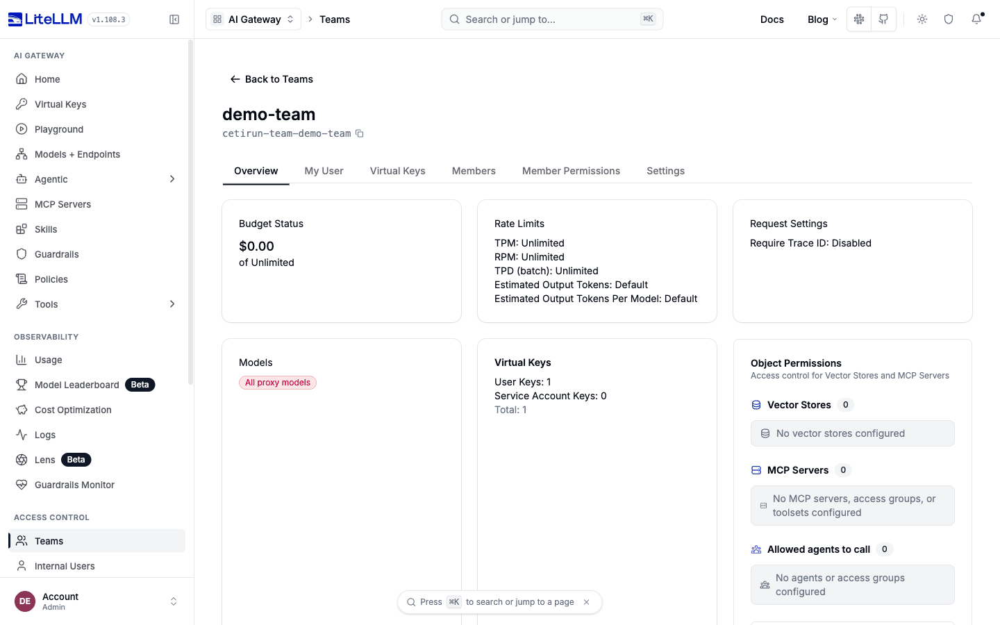

### 4. 哪些事在门户做，哪些在 LiteLLM 做

| 想做的事 | 在哪做 | 原因 |
|---|---|---|
| agent 能用哪些模型、预算多少、限流多少 | 门户 → Agent policies | 在控制台改 key，下次调和会被改回去 |
| 智能路由 | 门户 → Team | 以 Team 上的定义为准，operator 不监听控制台的修改 |
| 共享模型的部署和价格 | AI 网关的 Helm 配置 | 在控制台改会把整块配置写进数据库，Helm 里的值悄悄失效 |
| Team 总预算 | LiteLLM → Teams | CRD 里没有这一项 |
| 看用量、花费、请求日志，查 402 / 429 | LiteLLM → Usage / Logs | 门户没有用量页面 |
| 给集群外的程序发 key | LiteLLM → Virtual Keys | 这些 key 不归 operator 管 |

> [!IMPORTANT]
> LiteLLM 控制台只用来观察和补充，不要当成第二个管理入口。它能改的比它该改的多得多，改错了界面上没有任何提示。

控制台里的 **Agents** 菜单是 A2A agent 注册表，和这里的 agent 不是一回事，operator 没有接它，不要手工登记。

## 五、用量与日志

**Usage** 按时间看花费、请求数、token 数，下面按模型排行。

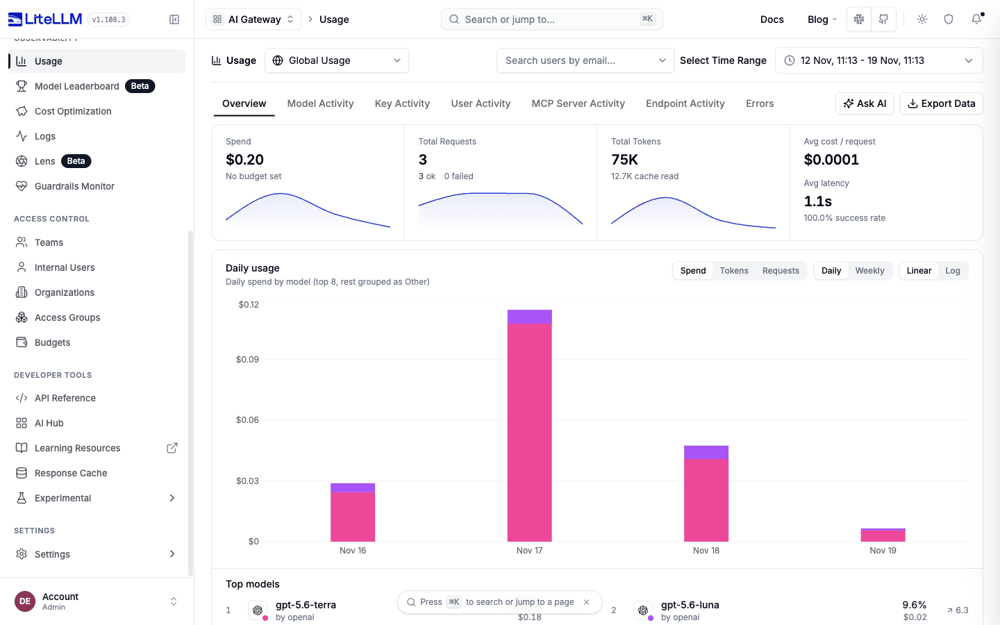

**Logs** 是逐条的请求日志：时间、花费、耗时、team、key、模型、token。

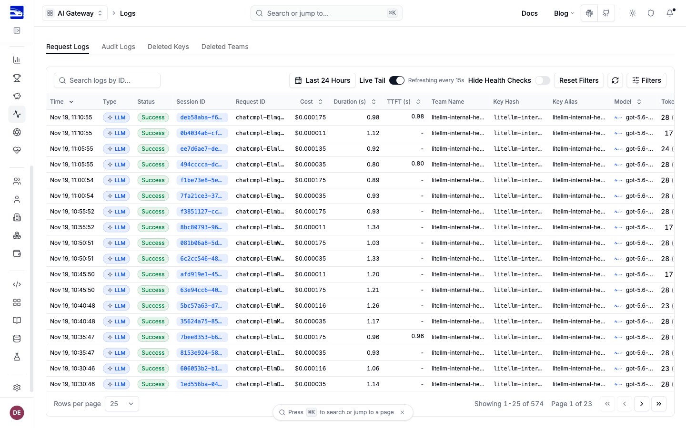

> [!NOTE]
> 日志里大部分是 `litellm-internal-health-check`：LiteLLM 每 5 分钟对每个模型做一次健康检查，每次都是真实的模型调用（每次约 0.0002 美元，一天约 570 条），它们也算进 Usage 的花费里。看 agent 自己的调用时，打开右上角的 **Hide Health Checks**。

预算的语义是"超了之后拒绝下一次"：花费在响应回来之后才算出来，挡不住单次请求超支。预算用完返回 402，超限流返回 429。

## 六、管理员：看所有 agent

**Admin → Agents** 列出所有人的实例，可以按 owner 查看状态。

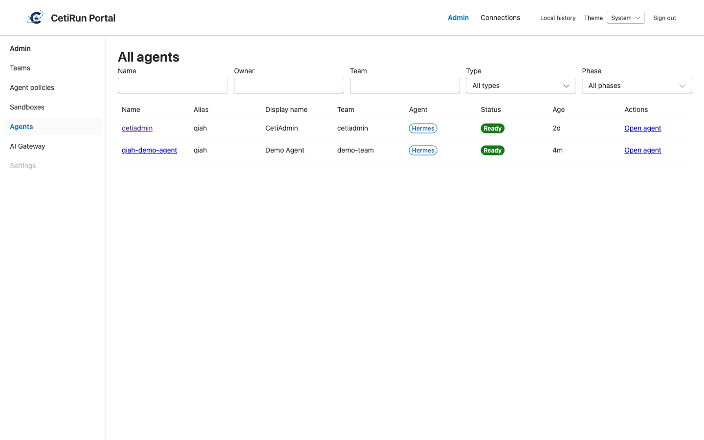

点进去能看到状态、conditions、Kubernetes 事件，可以改镜像、显示名、模型，也可以删除。

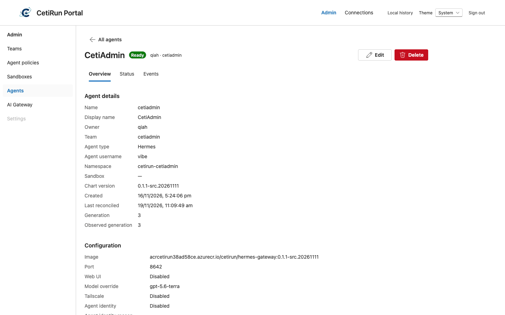

内置的 **CetiAdmin** 是管理员专用的 agent（Hermes），带平台诊断用的 `cetiadmin` skill，排查平台问题时可以先让它查。它能做什么由 Kubernetes RBAC 和准入策略决定。

**Skills**（Skill Marketplace）显示 skill 仓库的同步状态和各 Team 发布的版本，当前环境没有启用。

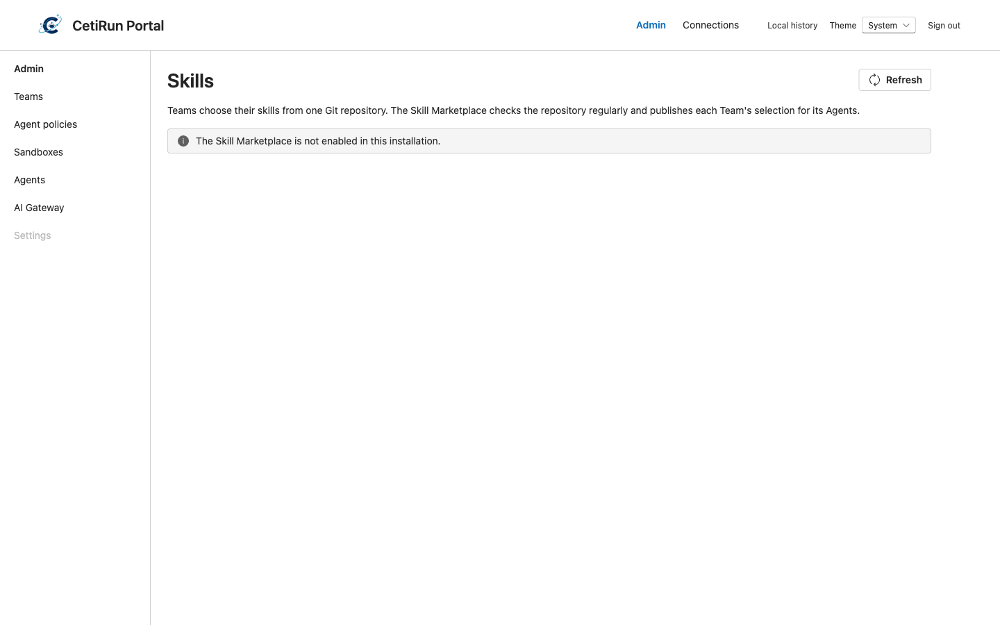

## 七、日志与治理边界

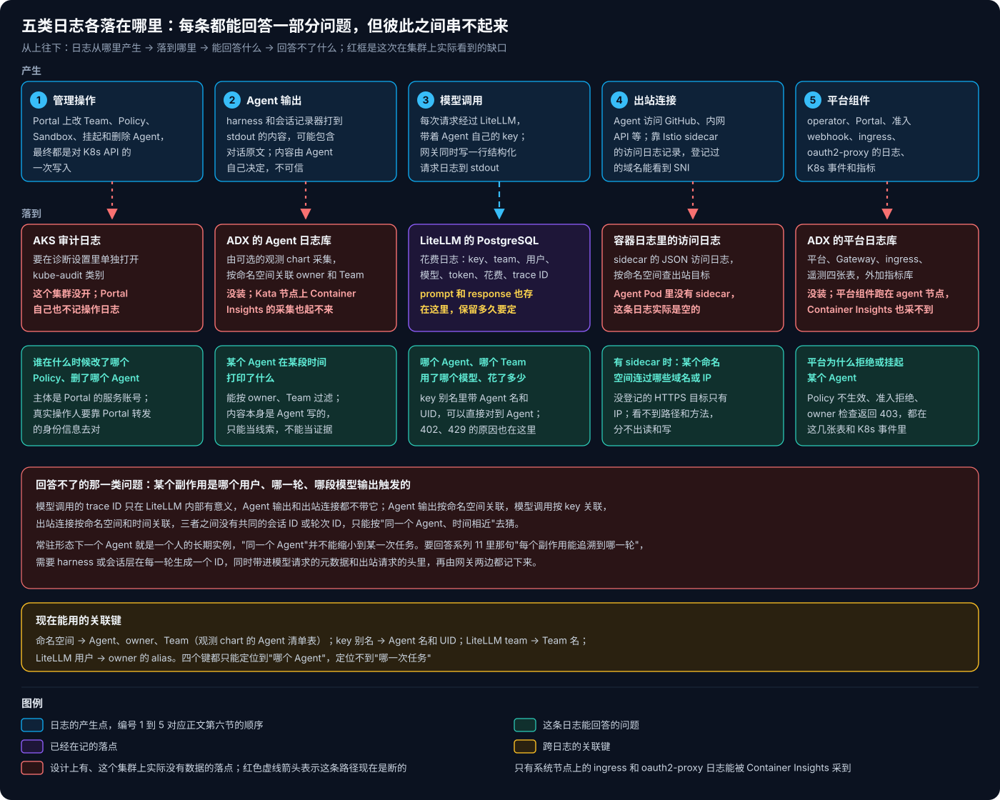

| 日志 | 记在哪里 | 当前环境 |
|---|---|---|
| 管理操作（改 Team、Policy，删 agent） | AKS 审计日志 | 没开 |
| agent 输出 | 可选的观测 chart，采进 Azure Data Explorer | 没装 |
| 模型调用 | LiteLLM，Logs 页 | **有数据** |
| 出站连接 | Istio sidecar 访问日志 | agent Pod 没有 sidecar，实际为空 |
| 平台组件 | 观测 chart / Container Insights | Kata 节点上采集 Pod 起不来，只有系统节点的 ingress 能采到 |

模型调用、agent 输出、出站连接之间没有共同的会话 ID 或轮次 ID，"某个副作用是哪一轮触发的"目前回答不了。


已经做到：harness 和 skill 白名单、模型白名单、每个 agent 的预算和限流、Kata 和 Sandbox 的资源边界，都由 CRD 声明、operator 执行。还没有：出站逐请求授权（公网默认放行）、高风险动作审批、每人或每个 Team 的容量配额、跨日志追溯。逐请求授权怎么做，见会话型 runtime 那边的 [系列 04：出站治理与逐请求授权](https://github.com/huqianghui/mindforge/blob/main/Azure/Azure-Kubernetes-Service/AKS-Agent-Runtime%E7%B3%BB%E5%88%9704%EF%BC%9A%E5%87%BA%E7%AB%99%E6%B2%BB%E7%90%86%E4%B8%8E%E9%80%90%E8%AF%B7%E6%B1%82%E6%8E%88%E6%9D%83.md)。

## 已知限制

- **建实例时不要开 Agent Identity**：operator 删除身份所需的 Graph 权限还没验证；
- **删实例会删 HOME 盘**，数据不可恢复；
- **改了源码要先重新构建再部署**：AI Gateway 页面要门户镜像和 Istio 入口规则都是新版才能用。`56-local-deploy.sh` 部署的是 ACR 里 `BUILD_VERSION` 那一版，不重跑 `46` 就部署，会把两者打回旧版，AI Gateway 菜单消失、嵌入的控制台报 refused to connect；
- 其余见 [README](../README.md#已知限制)。
