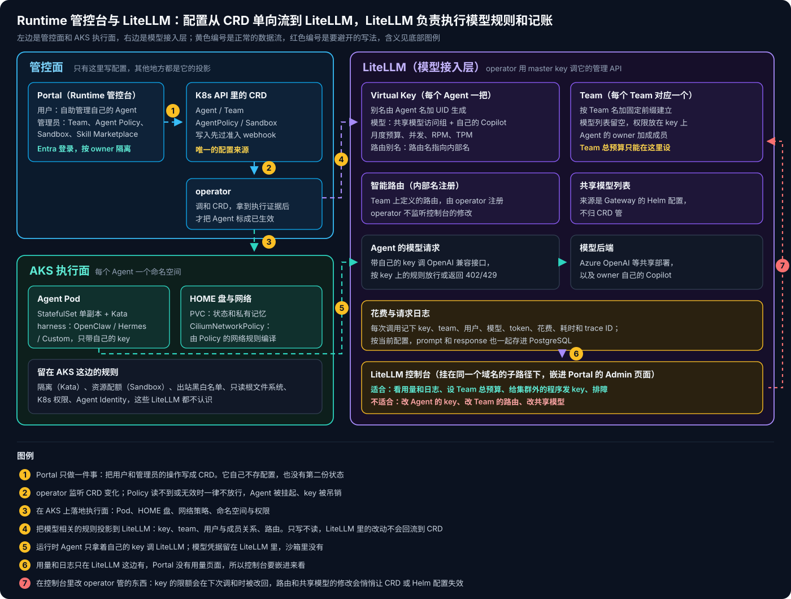
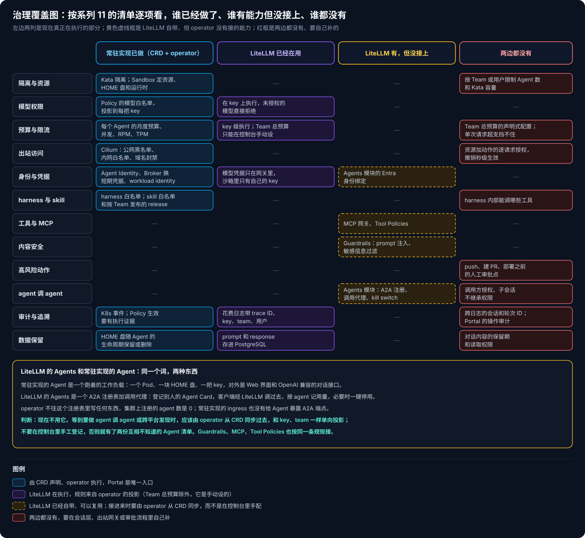

# CetiRun 使用指南

门户地址：<https://cetirun-qiah.eastus2.cloudapp.azure.com/>。用 Entra 账号登录，账号必须在 `cetirun-poc-users` 组里。

CetiRun 是**常驻型** runtime：每人一个长期运行的 agent 实例，状态都在它自己的 HOME 盘上，不做快照，不按会话回收。


门户有两部分：

- **用户侧**（`/`）：My Agents、工作区、Connections，每个人管理自己的 agent；
- **管理员后台**（`/admin`）：Teams、Agent policies、Sandboxes、Skills、All agents、AI Gateway，只有门户管理员能看到（部署时 `OWNER_ALIAS` 指定的人）。

## 一、对象之间的关系

用之前先理清四个对象，门户上的所有操作最后都是对它们的增删改。门户本身不保存配置，写入的是 Kubernetes CRD，由 operator 翻译成真正的执行配置。

| 对象 | 谁来建 | 定义什么 |
|---|---|---|
| **Sandbox** | 管理员 | 资源规格：运行时（Kata / gVisor / runc）、CPU 内存上限、HOME 盘大小和 StorageClass、临时盘上限 |
| **Agent Policy** | 管理员 | 规则：允许哪些 harness、哪些共享模型、能否用 GitHub Copilot、月度预算和限流、网络规则、只读根文件系统、Kubernetes API 权限、可用的 skill |
| **Team** | 管理员 | 把一个 Policy 和若干个 Sandbox 绑给一组人，再加上团队角色描述、共享 skill 存储和智能路由 |
| **Agent** | 用户 | 一个实例：选 Team 和 agent 类型后，operator 起一个单副本 StatefulSet、一块 HOME 盘和一组网络策略 |

**真正可复用的是 Policy 和 Sandbox，Team 只做绑定。** 每个团队建一个自己的 Team，哪怕规则完全一样也分开建，引用同一个 Policy 和 Sandbox 即可。原因是 operator 为每个 Team 在 AI 网关（LiteLLM）里建一个 team，用量和预算按它分开统计；两个团队共用一个 Team，花费就混在一起了。

当前在线环境里已经有：

- Sandbox `sandbox-demo01`：Kata，agent 容器 2 CPU / 4 GiB 上限，HOME 盘 10 GiB；
- Agent Policy `agent-policy-demo01`：允许 OpenClaw、Hermes、Custom 三种类型，共享模型 `gpt-5.6-luna`、`gpt-5.6-terra`，允许 GitHub Copilot，默认月度预算 50 美元（上限 100），每个 agent 每分钟 40 次请求、并发 10；
- Team `cetiadmin`：内置的管理员 agent CetiAdmin 所在的团队，普通用户不要选它。

## 二、管理员：第一次准备

普通用户能建 agent 的前提是至少有一个可选的 Team。顺序是 Sandbox → Policy → Team。

### 1. Sandboxes：定义资源规格

**Admin → Sandboxes → New**

- **Runtime**：`Kata`（每个 agent 一台轻量虚拟机，独立内核，推荐）、`gVisor`、`Container (runc, shared node kernel)`。后两种隔离弱，只用于测试；
- **Agent HOME**：HOME 盘的大小、StorageClass（只能选管理员批准过的）、访问模式；
- **Scratch size limit**：临时目录上限，实例重启后清空。

Sandbox 被某个 Team 引用时删不掉，要先让 Team 不再引用它。

### 2. Agent policies：定义规则

**Admin → Agent policies → New**，页面按块分：

- **Allowed harnesses**：允许建哪几种 agent（OpenClaw、Hermes、Custom）；
- **AI Gateway**：可用的共享模型、是否允许用户接自己的 GitHub Copilot、每个 agent 的月度预算、RPM / TPM / 并发，还可以给单个模型单独限流（**Add per-model limit**）；
- **Network**：入口的认证方式；公网出站默认放行，可以按 CIDR、FQDN、端口封禁（**Add blocked port**）；内网默认不通，要访问内部服务就在 **Internal network access** 里按"目标网段 + 端口"一条条加；
- **Identity**：是否允许实例申请 Entra Agent Identity（见"已知限制"，目前不要开）；
- **Kubernetes API access**：实例能否访问集群 API、要哪些权限；
- **Skill Marketplace skills**：这个 Policy 下可用的 skill 白名单。

保存后 operator 会做一次校验，列表里的 **Accepted** 是 `True` 才算生效。Policy 无效或读不到时，引用它的 agent 会被挂起，AI 网关的 key 会被吊销。

### 3. Teams：绑定给一组人

**Admin → Teams → New**

- **Agent Policy**：选上一步的 Policy；
- **Allowed Sandboxes / Default Sandbox**：这个团队能用哪几种规格，默认用哪个；
- **Role / Description**：团队角色说明，会作为上下文写进 agent，例如"AKS Engineer，负责集群排障"。它只是给 agent 的提示，不授予任何权限；
- **Skills**：从 Skill Marketplace 里勾选，或写 npm skill 包（每行一个，如 `npm:@scope/skill-a`）；
- **Skill storage**：可选，挂一个团队共享的 skill 存储（Blob 存储账户里的一个容器），团队里所有 agent 都能读到；
- **Smart routing**：可选，定义一个路由名，背后是四档模型加一个分类器。agent 用路由名调用，网关按问题难度转发到不同模型。

Team 不维护成员名单。谁能用它，取决于谁能登录门户，用户建 agent 时自己选 Team。已有 agent 的 Team 改设置时，可能要先挂起这些 agent。

### 4. Skills：Skill Marketplace

**Admin → Skills** 显示 skill 仓库的同步状态：仓库地址和分支、合法的 skill（名字、版本、文件数、大小）、不合法的目录和原因（例如名字必须是小写加连字符），以及各 Team 当前发布的是哪个版本。skill 按版本固定，仓库里改了不会自动影响已经在用的 Team。

## 三、用户：创建和使用自己的 agent

### 1. 创建

**My Agents → Create**

- **Team**：选自己的团队（不要选 `cetiadmin`）；
- **Agent Type**：`Hermes`（默认）、`OpenClaw`、`Custom`。Custom 要填自己的镜像地址和运行用户名，私有仓库可以填拉取凭据；如果镜像自带 Web 界面，要提供 `/ui/<实例名>/` 和 `/healthz` 两个路径；
- **Display Name / Agent Name**：可以留空，自动生成；
- **Use shared models**：用 Policy 允许的共享模型，**Default model** 可以指定默认用哪个；
- **Use GitHub Copilot**：Policy 允许时可以接自己的 Copilot 账号；
- **Tailscale Auth Key**：可选，让 agent 加入自己的 tailnet；
- **Enable Microsoft Entra Agent Identity**：**不要勾选**，原因见"已知限制"。

提交后实例进入 Provisioning，几分钟后变成 Ready。第一次在某个节点上拉镜像会慢一些。

### 2. 工作区的三个入口

在 My Agents 里点开实例进入工作区，左侧有三个入口。三个入口连的是同一个 Pod 里的不同容器，都要先过 Entra 登录，再过 owner 检查：**只有实例的 owner 能进**。管理员在后台能看到所有人的 agent，但进不了别人的工作区。

| 入口 | 连到哪里 | 用来做什么 |
|---|---|---|
| **Agent UI** | 主容器里 harness 自带的 Web 界面 | 日常主入口：交代任务，看回复和工具调用，管理会话 |
| **Terminal** | 主容器里的网页 shell（ttyd） | 绕过 agent 直接操作它的环境：同一个用户、同一块 HOME 盘，看文件、跑命令、装工具、查 agent 为什么出错 |
| **Desktop** | 桌面边车里的远程桌面（noVNC）和 Chrome | 看 agent 用的浏览器，必要时接手 |

几个要点：

- **Agent UI 有自己的一层登录**，凭据在工作区 **Overview** 里（**Copy credential**），和门户的 Entra 登录是两回事；
- **Terminal 是唯一正式的 shell 入口。** 集群上有准入策略拒绝对 agent Pod 做 `kubectl exec`，`kubectl port-forward` 也连不到 Kata 虚拟机里的端口，管理员也没有别的路进去；
- **Desktop 用来替 agent 过它过不了的关**，比如需要验证码或 MFA 的登录。人在桌面里登录一次，cookie 留在这个 Chrome 里，agent 之后接着用。agent 通过本机的 CDP 端口操作这个浏览器，人在桌面上能实时看到。

### 3. Overview：查看和修改配置

工作区的 **Overview** 显示实例状态、类型、镜像、用户名、Team、Gateway Token、Tailscale 状态。**Edit Agent** 可以改显示名、默认模型、是否提供 Web 界面；类型、owner、Team、Sandbox 建好之后不能改，要换只能删了重建。

**Delete Agent 会连 HOME 盘一起删掉**（默认 StorageClass 的回收策略是 Delete），删之前先把需要的文件拷出来。

### 4. Connections：让 agent 代表你访问 Microsoft 服务

**Connections** 页管理委托连接：授权 agent 以你的身份访问 Microsoft Graph 或 Azure ARM，比如读邮件、日历，或查询订阅资源。连接是从 agent 侧发起的，在 agent 里选 **Add identity** 完成授权后会出现在这里。这里能看到每个连接被哪些 agent 用着，删除连接前要先把这些 agent 的访问撤掉。

这个功能目前需要租户管理员同意后才能用。

## 四、AI 网关：看用量和预算



模型调用都走 AI 网关（LiteLLM）。operator 根据门户上的配置，往 LiteLLM 里写这几样东西：

- 每个 Agent 一把 key，带模型白名单、月度预算、RPM / TPM / 并发；
- 每个 Team 一个 LiteLLM team；
- agent 的 owner 作为 LiteLLM 用户加进对应 team；
- Team 上定义的智能路由。

agent 只拿着自己的 key 调网关，模型凭据不进沙箱。预算用完返回 402，超限流返回 429。

**Admin → AI Gateway** 里嵌着 LiteLLM 控制台，也可以直接打开 `/ai-gateway/ui/`。要登录两次：先过 Entra（嵌在门户里时无感），再用 LiteLLM 的 admin 账号，密码这样取：

```bash
kubectl get secret -n cetirun-system cetirun-ai-gateway-auth -o jsonpath='{.data.ui-password}' | base64 -d
```

**哪些事在门户做，哪些在 LiteLLM 控制台做：**

| 想做的事 | 在哪做 |
|---|---|
| agent 能用哪些模型、预算多少、限流多少 | 门户 → Agent policies（在控制台改 key，下次调和会被改回去） |
| 智能路由 | 门户 → Team（以 Team 上的定义为准） |
| 共享模型的部署和价格 | AI 网关的 Helm 配置（在控制台改会让 Helm 配置悄悄失效） |
| Team 总预算 | LiteLLM 控制台 → Teams（CRD 里没有这一项） |
| 看用量、花费、请求日志，查 402 / 429 的原因 | LiteLLM 控制台（门户没有用量页面） |
| 给集群外的程序发 key | LiteLLM 控制台（这些 key 不归 operator 管） |

> [!IMPORTANT]
> LiteLLM 控制台只用来观察和补充，不要当成第二个管理入口。它能改的东西比它该改的多得多，改错了界面上没有任何提示。

LiteLLM 控制台里的 **Agents** 菜单是 A2A agent 注册表，和这里的 Agent 不是一回事，operator 没有接它，不要在里面手工登记。

预算是"超了之后拒绝下一次"：花费在响应回来之后才算出来，所以挡不住单次请求超支。

## 五、管理员：看和管所有 agent

**Admin → All agents** 列出所有人的实例。点进去能看到状态、当前 conditions、Kubernetes 事件，可以改镜像、显示名、模型、是否提供 Web 界面，也可以删除。类型、用户名、owner、Team、Sandbox 和拉取凭据在这里同样是只读的。

内置的 **CetiAdmin** 是一个管理员专用的 agent（Hermes），带平台诊断用的 `cetiadmin` skill，排查平台问题时可以先让它查。它能做什么，由 Kubernetes RBAC 和准入策略决定，团队上下文不授予任何权限。

## 六、日志在哪里


| 日志 | 记在哪里 | 当前环境 |
|---|---|---|
| 管理操作（改 Team、Policy，删 agent） | AKS 审计日志 | 没开 |
| agent 输出（harness 和会话记录器的 stdout） | 可选的观测 chart，采进 Azure Data Explorer | 没装 |
| 模型调用（key、team、模型、token、花费、耗时） | LiteLLM，在控制台里看 | **有数据** |
| 出站连接 | Istio sidecar 访问日志 | agent Pod 没有 sidecar，实际为空 |
| 平台组件（operator、门户、webhook、ingress） | 观测 chart / Container Insights | Kata 节点上采集 Pod 起不来，只有系统节点上的 ingress 能采到 |

现在排查问题主要靠三处：LiteLLM 控制台的请求日志、工作区的 Terminal、管理员后台 agent 详情里的事件。

## 七、治理边界



已经做到的：harness 白名单、skill 白名单和按 Team 发布、模型白名单、每个 agent 的预算和限流、Kata 和 Sandbox 的资源边界。这些都由 CRD 声明、operator 执行，执行不了就不放行。

还没有的，用之前要心里有数：

- **出站逐请求授权**：公网默认放行，只能按网段、域名、端口封禁，做不到"某个 agent 对某个资源的某个动作"这一级；
- **高风险动作审批**：push、建 PR、部署都由 agent 自己决定，中间没有人工审批；
- **容量配额**：没有"一个人或一个 Team 最多几个 agent"的上限；
- **跨日志追溯**：模型调用、agent 输出、出站连接之间没有共同的会话 ID 或轮次 ID。

另外，Terminal 给的是沙箱里的完整 shell，Desktop 里的 Chrome 以 `--no-sandbox` 启动，这两个入口的隔离只靠 Kata 虚拟机和 owner 检查。

## 已知限制

见 [README](../README.md#已知限制)。最常碰到的两条：

- **建实例时不要勾选 Agent Identity**：operator 删除身份所需的 Graph 权限还没验证；
- **删实例会删 HOME 盘**，数据不可恢复。
