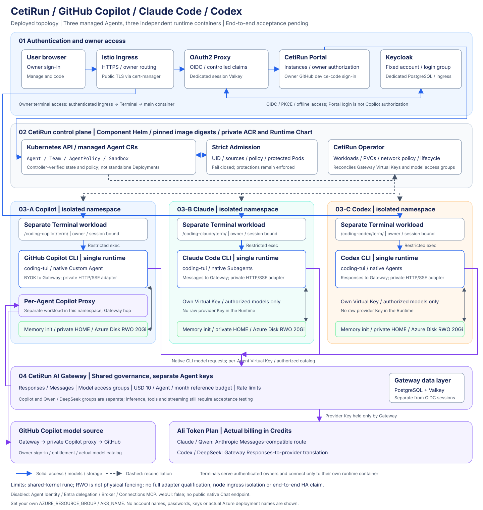

# CetiRun Coding Agent Runtimes

**English**

Run **GitHub Copilot CLI, Claude Code, and Codex CLI as three independent,
managed CetiRun Agents on Azure Kubernetes Service (AKS)**. Each Agent has its
own native runtime container, authenticated terminal, persistent HOME, and
AI Gateway Virtual Key.

The application in [`app/`](app/README.md) runs real native tools, not simulated
coding responses. Infrastructure readiness and end-to-end model acceptance are
tracked separately.

## What is CetiRun?

CetiRun is a Kubernetes-based managed runtime for persistent AI agents and AI
applications on AKS. Its Operator reconciles agent resources and lifecycle,
while its self-service Portal provides authenticated access and management.
The platform combines execution policies, persistent storage, terminal access,
and governed model routing.

CetiRun includes OpenClaw and Hermes harnesses. This example uses the existing
**Custom Harness** contract to host three additional native coding runtimes;
it does not introduce a new CRD type or combine all three CLIs in one image.
It hosts the CLIs, not the GitHub cloud agent service, Claude hosted sessions,
or Codex Web.

This example is maintained directly in the CetiRun repository at
[`examples/coding-agents/`](./), not as a separate repository or Git submodule.
Use the platform source in [`../../app/`](../../app/) and follow the
[development guide](../../DEVELOPMENT.md) for platform checks. No separate
reference checkout is required.

| Managed Agent | Native runtime | Project role configuration | Configured model route |
| --- | --- | --- | --- |
| `coding-copilot` | GitHub Copilot CLI | `app/profiles/.github/agents/` | GitHub Copilot through a private per-Agent proxy |
| `coding-claude` | Claude Code | `app/profiles/.claude/agents/` | Qwen through an Anthropic Messages-compatible route |
| `coding-codex` | Codex CLI | `app/profiles/.codex/agents/` | DeepSeek through Gateway Responses translation |

These are different native agent formats and delegation mechanisms, not a
universal prompt-runner abstraction. Model availability must be checked against
the Agent's actual authorized catalog.

## Deployment status

**Historical deployment snapshot: 2026-11-09.** These results were recorded
before the example was imported into this repository; they are not validation
of a fresh checkout or another environment. The runtime rollout, platform health,
Agent/storage identities, terminal login redirects, and strict admission were
rechecked on this date; other entries summarize earlier deployment evidence:

| Area | Recorded result |
| --- | --- |
| Control plane | Operator, Portal, AI Gateway, and strict admission each had 2/2 ready replicas |
| Managed Agents | All three were `Ready`, with `PolicyApplied=True`; separate terminal workloads were ready |
| Runtime update | Three rebuilt images published to private ACR and rolled out sequentially; running immutable digests verified, original HOME PVC identities and PV bindings retained |
| Persistence | Each Agent has a private 20Gi Azure Disk RWO HOME; cross-node remount was tested |
| Authentication | HTTPS OIDC discovery, PKCE, controlled identity claims, login group, and owner `offline_access` permission verified; unauthenticated terminal requests returned 302 |
| Native execution | Bounded `native-single-start` registration; CPU/memory, read-only root, and scoped two-node TCP/UDP egress checks completed |
| Model governance | Actual per-Agent Virtual Keys verified with USD 10/month reference management budgets |
| End-to-end acceptance | Full browser session, Copilot entitlement, real coding/model calls, tools/streaming/cancellation, and lifecycle acceptance are not recorded as complete |

`Ready`, a successful `/healthz`, or an authorized catalog does **not** prove
that a provider/model/CLI combination can complete a coding task.

## Architecture



[Open the SVG](docs/architecture.svg). All SVG labels are English. The diagram
is self-contained and uses no Mermaid, external images, or scripts.

```text
Browser / owner
    |
    v
Istio Ingress <-> OAuth2 Proxy + session Valkey <-> Keycloak + PostgreSQL
    |
    +-- Portal --> Kubernetes API: Agent / Team / AgentPolicy / Sandbox
    |                         |                        |
    |                   Strict admission           Operator
    |                                                  :
    +-- Owner-bound terminal sessions                  : reconcile
                 |                                     :
        +--------+-------------------+-----------------+
        |                            |                 |
  Copilot namespace          Claude namespace    Codex namespace
  Terminal -> Copilot CLI    Terminal -> Claude   Terminal -> Codex
  Memory init               Memory init          Memory init
  Private HOME PVC          Private HOME PVC     Private HOME PVC
        |                            |                 |
        +----------------------------+-----------------+
                                     |
                       AI Gateway / per-Agent Virtual Key
                       Model groups / budget / rate limits
                       Gateway PostgreSQL + Gateway Valkey
                              |                 |
                   Private Copilot proxy    Ali Token Plan
                   in Copilot namespace     Qwen / DeepSeek
                              |
                     GitHub Copilot models
```

The `:` lines denote control-plane reconciliation, not inference traffic.
Each terminal uses restricted Kubernetes exec into **its own Agent's main
container**. The private Copilot proxy is a separate workload, not an
additional coding runtime in the main container.

| Layer | Responsibility | Boundary |
| --- | --- | --- |
| Authentication | Istio, cert-manager, OAuth2 Proxy, and Keycloak provide HTTPS, OIDC/PKCE, and controlled owner claims | Portal login is not Copilot model authorization or a GitHub repository connection |
| Control plane | Portal manages instances; admission validates resources; Operator reconciles workloads, policies, storage, and model access | These are real managed Agent CRs, not standalone Deployments presented as Agents |
| Execution | One native runtime per main container, a separate terminal workload, and Memory init per Agent | Non-root `1024:1024`; no shared writable HOME or checkout across Agents |
| Storage | Private Azure Disk RWO HOME; workspace at `$HOME/workspace` | RWO is not physical single-writer fencing; sessions do not migrate across runtimes |
| Model access | AI Gateway authorizes individual Virtual Keys, model groups, budgets, and rate limits | Raw provider keys are not injected into runtime containers |
| Delivery | Private ACR stores pinned runtime/platform images and the Runtime Helm Chart | Local deployment inputs and credentials stay outside Git |

**Interactive request path:** owner login, terminal/session authorization,
restricted exec, `coding-tui`, native CLI, AI Gateway, authorized model source,
workspace edits, and test execution. Portal manages resources; it does not
replace the native inference loop.

`server.py` also implements private HTTP/SSE endpoints: `/healthz`, `/v1/models`,
and `/v1/chat/completions`. The application has no independent public
authentication layer. Keep **`webUI: false`** and do not expose its port 8080
through an anonymous Ingress or LoadBalancer.

HTTP and terminals share Gateway routing and explicit platform instructions from
`$HOME/.agents`, with native skill discovery for each CLI. Copilot uses an
adapter-owned empty provider registry and environment-only Gateway credentials
without changing the user's existing config or writing the key to adapter files.
Platform Memory is connected only when supplied; `off` / `no-capture` restrictions
are preserved. HTTP accepts up to 1 MiB, 100 messages and 64 KiB per user input,
with a 600-second task deadline and UTF-8-safe SSE frames of at most 64 KiB.
History is not silently trimmed; terminals have no HTTP task deadline.
See [adapter details and offline checks](app/README.md). These revisions are
published and deployed to all three managed Agents. The actual built images
passed six offline native-CLI contract probes; real owner/model acceptance
remains outstanding.

## Runtime environment

The workstation runs development and administration tools; the coding CLIs
run in Linux containers on AKS. A developer does not need to install all three
CLIs on the workstation to use the browser terminals.

### Workstation tools

Versions below were checked locally on **2026-11-09**. They are an environment
snapshot, not universal minimum versions or instructions to upgrade a shared
machine.

| Tool | Requirement and purpose | Recorded local version |
| --- | --- | --- |
| OS / shell | macOS or Linux with Bash-compatible tooling; the recorded workstation is macOS ARM64, cross-building Linux amd64 images | macOS / ARM64 |
| Python | Python 3.11+ for application checks; PyYAML is additionally required by local deployment helpers | 3.14.7 |
| Azure CLI (`az`) | Required for Azure administration, approved subscription access, AKS/ACR operations, and registry authentication | 2.92.0 |
| Azure Developer CLI (`azd`) | Optional for this component Helm route; needed only if a separate, reviewed `azd` workflow is introduced | 1.37.2 |
| Docker | Required to build/test images locally; use a running Linux-container engine | Docker CLI 29.9.2 |
| Docker Buildx | Required for `linux/amd64` builds; an ARM64 workstation needs a builder capable of targeting amd64 | 0.38.1 |
| Kubernetes CLI (`kubectl`) | Required for administrator operations; keep supported client/server version skew, preferably matching the server minor | Client 1.36.1; recorded server 1.37.1 |
| Helm | Required for component and Runtime charts; the reviewed Helm 4 helper uses `--server-side false` to preserve AKS-managed field ownership | 4.3.1 |
| Git, GNU Make-compatible `make`, OpenSSL, and curl | Source access, local checks/builds, certificate verification, and diagnostics | Available tools; versions not pinned here |
| Go / Node.js | Only needed when rebuilding upstream platform services/frontend; follow the pinned upstream manifests | Not prerequisites for the native Python application |

`az` and `azd` are different tools. **Installing Azure Developer CLI does not
make `azd up` the deployment entry point for this project.** The current
installation is managed through reviewed component Helm inputs and helpers.

Check your environment before building or administering the platform:

```bash
python3 --version
python3 -c 'import yaml; print("PyYAML", yaml.__version__)'
az version
azd version
docker --version
docker buildx version
kubectl version --client
helm version --short
```

The PyYAML check is relevant to deployment helpers; `azd version` is optional
for the current route. Version checks do not prove that Docker is running,
Azure authentication is valid, or a cluster is qualified. Use approved
subscription access and a dedicated kubeconfig/context; deployment helpers
also verify the API address and `kube-system` UID before writing.

### AKS and container requirements

| Area | Required environment / recorded baseline |
| --- | --- |
| Kubernetes | Recorded deployment target: AKS **1.37.1**; the pinned upstream full-deploy route requires 1.37+. API availability and sandbox qualification must still be checked for another cluster |
| Nodes / images | Linux amd64 nodes and `linux/amd64` images; the active runtime is `runc`, not Windows containers or assumed Kata VM isolation |
| Networking | Managed Istio, external HTTPS ingress, enforced Cilium/NetworkPolicy behavior, working DNS, and approved API/model egress |
| Admission | Required admission APIs, strict admission services, verified TLS, and permission to manage the reviewed cluster-scoped resources |
| Storage | Azure Disk CSI and the reviewed StorageClass; one private 20Gi RWO HOME per Agent |
| Registry | Private ACR image pulls for nodes plus read-only OCI Runtime Chart access for the Operator; pinned source-compatible artifacts |
| Identity / TLS | Production Keycloak OIDC, OAuth2 Proxy, allowed groups, exact callback, PKCE, cert-manager, and valid public/internal certificates |
| Capacity | CPU/memory, disk quota, and rollout headroom for the control plane, three Agents, terminal helpers, databases, and caches |
| Model access | Authorized Copilot account or permitted Ali Token Plan access, Gateway-only provider credentials, and per-Agent Virtual Keys |

The runtime images provide Python, Git, required HOME initialization tools,
and exactly one pinned native CLI each. Browser users do not need `az`, `azd`,
Docker, Helm, or Kubernetes credentials inside the runtime container.

## Use the deployed Agents

### 1. Sign in

Open your configured Portal at `https://<your-portal-host>`. For this local
deployment, initial credentials are stored only in
`.deployment/oidc-owner-login.json` with permissions `0600`. Open the file
locally, change the temporary password on first login, and never share or
commit it. After a password change, the bootstrap password may no longer work.

Open the relevant authenticated terminal:

| Agent | URL |
| --- | --- |
| Copilot | `https://<your-portal-host>/coding-copilot/term/` |
| Claude Code | `https://<your-portal-host>/coding-claude/term/` |
| Codex | `https://<your-portal-host>/coding-codex/term/` |

For Copilot, complete the owner's **GitHub Copilot sign-in in Portal** first.
The account must offer the requested model. This model-source authorization
does not grant repository access or replace any separate CLI product sign-in.
Claude and Codex use their Gateway Virtual Keys; do not paste provider keys
into the terminal or switch to personal provider endpoints.

### 2. Check the authorized catalog

Run the following **inside the Agent's browser terminal**, not on your laptop.
It lists authorized model IDs without making an inference call or printing keys:

```bash
python3 -c 'import sys; sys.path.insert(0,"/opt/cetirun-coding"); from native import Gateway; print("\n".join(Gateway.from_environment().models()))'
```

Use the corresponding model ID actually returned by that catalog, not a
display name or an assumed alias:

```bash
MODEL='<authorized-model-id>'
python3 /opt/cetirun-coding/server.py doctor --model "$MODEL"
coding-tui --model "$MODEL"
```

`doctor` should report `"requestedModelAuthorized": true`; it does not test
inference. Stop if catalog lookup or authorization fails. Do not silently
substitute a different model or bypass Gateway.

### 3. Complete a real coding smoke test

Give each native CLI this task separately:

> Work only in a new `smoke-test` directory under the current workspace.
> Create `calculator.py` with `add(a, b)`, and `test_calculator.py` using
> Python unittest for integers, negative values, and decimals. Actually run
> `python3 -m unittest discover -s smoke-test -p 'test_*.py' -v`.
> Report changed files, test output, and the exit code. Do not install
> dependencies, read credentials, commit, or push.

Verify that files were really created and tests passed, rather than accepting
a proposed code listing. After exiting the CLI, independently run:

```bash
cd "$HOME/workspace"
python3 -m unittest discover -s smoke-test -p 'test_*.py' -v
```

Reconnect to the terminal and confirm the files remain. Separately test
cancellation and approved Portal suspend/resume operations. Reconnecting is
not proof of restart retention; deleting an Agent or PVC is not a restart
procedure. Real model tasks consume the applicable provider allowance.

## Build and configure

### Local development

Use Python 3.11+ for checks and Docker with Buildx for images. Builds target
**Linux amd64**, download pinned official native artifacts, and verify their
SHA-256 hashes. They do not use remote installers or embed credentials.

From the CetiRun repository root:

```bash
cd examples/coding-agents
make -C app test check
make -C app build
```

The build produces `cetirun-copilot:local`, `cetirun-claude:local`, and
`cetirun-codex:local`. These commands **do not deploy AKS or test paid model
inference**. See [application details](app/README.md) for verified artifact
caching and adapter limits.

Real startup requires platform-injected `OPENAI_BASE_URL` and `OPENAI_API_KEY`;
the latter must be an **Agent Virtual Key**, not a raw provider key. Missing
configuration fails closed. Native role templates initialize the workspace
without overwriting existing user-maintained files.

### Platform configuration

The existing deployment uses **component Helm + production Keycloak HTTPS
OIDC**, not the Entra-dependent full deployment route. Reviewed platform source,
matching chart/image digests, Kubernetes/Helm/Azure tools, and Python with
PyYAML are administrator prerequisites.

Local configuration and evidence are intentionally ignored by Git:

| Path | Purpose |
| --- | --- |
| `.deployment/cetirun.environment.yaml` | Target cluster/context/UID, domains, OIDC, image pins, component values, source and coordination bindings |
| `.deployment/native-team.yaml` | Sandbox, AgentPolicy, and Team definitions |
| `.deployment/agents.yaml` | Three managed Agent definitions |
| `.deployment/billing.inputs.yaml` | Credits constraints and explicitly labeled USD management estimates |
| `.deployment/platform-artifacts.json` | Matching platform image digests |
| `.deployment/managed-agents-verification.json` | Recorded managed Agent readiness evidence |
| `.deployment/native-platform-registration.json` | Native topology registration and bounded claims |

For a different environment, fill in your own `AZURE_RESOURCE_GROUP`,
`AKS_NAME`, subscription, registry, DNS, kubeconfig/context, and verified cluster
UID. Do not reuse another cluster's source/coordination UIDs or credentials.
The ignored `.deployment/` files are **not a portable, one-command installer**
and are not present in a clean checkout. Paths beginning with `.deployment/`
in this document are relative to `examples/coding-agents/`.

For a new environment, follow the repository's
[platform deployment guide](../../app/cetirun-platform/README.md#deploy-the-platform).
The historical `.deployment/render_component_values.py` and
`.deployment/deploy_control_plane.py` helpers are not distributed with this
example. Rendering is not deployment. Do not blindly run
platform `make deploy`, old `infra/istio/deploy.sh`, reapply running Agent
definitions, or rerun native source registration while Agents exist.
Live configuration changes must use the approved coordination/lifecycle path.

## Important considerations

### Authentication and credentials

Keep HTTPS, PKCE, controlled identity claims, login groups, and strict admission
enabled. The current route disables Agent Identity creation/cleanup, Entra
delegation, Broker, and Connections MCP; provisioned but disabled components
are not part of the active request path.

If Keycloak reports `Offline tokens not allowed for the user or client`, check
the client's `offline_access` scope and the owner's matching realm role.
`.deployment/verify_oidc.py` defaults to read-only checks; its explicit
`--repair-offline-access` mode adds only the missing role through the approved
private TLS admin connection. It does not reset passwords. Restart login from
Portal instead of refreshing an already consumed OAuth callback. Never expose
the admin API publicly to perform the repair.

Keep provider credentials in Gateway Secrets. The local hidden-input rotation
tool is:

```bash
python3 .deployment/set_model_secret.py
```

Run it interactively on the administrator's machine. It verifies the target,
does not print the key, and neither calls models nor automatically restarts
Gateway. Rotation still requires an approved rollout and verification.

### Model compatibility and billing

Claude Code with Qwen is a third-party Anthropic-compatible route, not a claim
of official Claude model support. Codex with DeepSeek requires working
Responses translation. Validate tools, streaming, errors, and cancellation for
the exact CLI/provider/model combination.

**Ali Token Plan bills in Credits.** The configured USD 10/Agent/month budget
and Gateway spend are reference management estimates, not Credits quotas or
provider invoices. Do not infer a fixed USD/Credit conversion, switch to
pay-as-you-go, or treat a catalog check as a billing-enforcement test.

Respect the plan's owner/seat and interactive-use restrictions. Confirm that
the Gateway forwarding arrangement is permitted before real use. Automated
shared-model health probes are disabled; do not run unattended paid API tests.
Cancellation does not undo tool side effects or charges already incurred.

### Isolation and operations

The active sandbox uses ordinary **`runc` containers sharing the node kernel**,
not Kata VM isolation. Scoped CPU/memory, read-only-root, RWO remount, and
two-node TCP/UDP egress evidence does not establish full Cilium adapter
qualification, node ingress isolation, or physical storage fencing.

Keycloak, its database and identity ingress, Gateway PostgreSQL, and the Valkey
stores have single-replica limitations. This is not an end-to-end HA claim.
OIDC Proxy uses Recreate updates and may briefly interrupt login. Admission
surge scheduling has previously been constrained by available CPU; preserve
PDBs and ownership checks rather than force-deleting workloads or taking over
AKS-managed webhook fields.

Internal leaf certificates require rotation before **2027-02-06**; the current
chart pull credential requires rotation before **2027-11-08**. Public
certificates are managed by cert-manager. Never publish private keys,
bootstrap credentials, kubeconfigs, or deployment evidence containing secrets.

## Project layout and further reading

| Path | Contents |
| --- | --- |
| [`app/`](app/README.md) | Real runtime adapter, build instructions, HTTP/SSE behavior, and application limits |
| [`app/profiles/`](app/profiles/) | Native Copilot, Claude Code, and Codex role templates |
| [`docs/architecture.svg`](docs/architecture.svg) | English-only architecture diagram |
| [`examples/coding-runtime/`](examples/coding-runtime/README.md) | Earlier offline interface demonstration, explicitly labeled `OFFLINE MOCK`; not the deployed application |
| [`../../app/`](../../app/) | Platform source in the same repository |
| `.deployment/` | Ignored local configuration, scripts, credentials, and deployment receipts |
